<!--
  HOW TO EDIT THIS FILE
  - Text you can change sits between "EDIT" and "END EDIT" comments. Everything else is layout.
  - The line starting with "TODO" is a placeholder. Replace it before you publish.
  - To change a picture, swap the file in assets/ and keep the same file name.
-->

<a href="#about"></a>

  <a href="https://github.com/matthew-spina29?tab=repositories"></a>
  <a href="https://mspina.pages.dev/"></a>
  <a href="https://www.linkedin.com/in/matthew-spina29/"></a>
  <a href="https://www.credly.com/users/matthew-spina/badges/credly"></a>

<!-- EDIT: About. Two or three sentences, first person. -->

I'm a cybersecurity analyst.

TODO: one or two sentences on what you work on and what you are building or learning.

<!-- END EDIT -->


<!-- EDIT: Projects. One table row per project: the picture on the left, the words on the right. -->

<table>
<tr>
<td width="50%"></td>
<td width="50%"><b>The Mirelle Loop</b> Planned · 2027  A sandbox simulation where AI agents form their own societies, to observe how cooperation, conflict and governance emerge in a secured environment.</td>
</tr>
<tr>
<td width="50%"></td>
<td width="50%"><b>AI Red Teaming Sims</b> 2026  A self-contained home-lab project that uses AI to pentest, analyze malware and test its own guardrails, all inside an isolated lab.</td>
</tr>
<tr>
<td width="50%">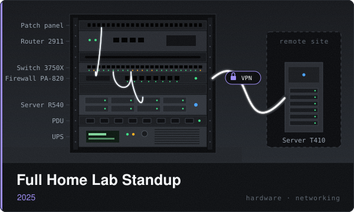</td>
<td width="50%"><b>Full Home Lab Standup</b> 2025  Stood up a home lab featuring:
<ul>
<li>PowerEdge R540 server</li>
<li>PowerEdge T410 server at a remote site, reached over a VPN tunnel</li>
<li>Palo Alto PA-820 firewall</li>
<li>Cisco 2911 K9 router</li>
<li>Cisco Catalyst 3750X switch</li>
<li>UPS battery backup</li>
</ul></td>
</tr>
</table>


<!-- END EDIT -->


<!-- EDIT: Skills. -->

| Area | Tools and skills |
| :-- | :-- |
| **Governance** | Risk Management Framework (RMF), compliance mapping, risk assessment, security policy |
| **Architecture** | Active Directory, cloud security architecture, RAG pipelines, SIEM implementation and fine-tuning |
| **Detection** | Elastic Stack, Splunk, Zeek, MITRE ATT&CK mapping |
| **AI security** | AI red teaming, prompt injection, guardrail evaluation, LLM vulnerability assessment |
| **Certifications** | ISC2 CGRC · Associate of ISC2 (CISSP exam passed) · CompTIA SecurityX, all on [Credly](https://www.credly.com/users/matthew-spina/badges/credly) |

<!-- END EDIT -->


<!-- EDIT: Experience. One row per role. -->

| Role | Organization | Years |
| :-- | :-- | --: |
| **Cybersecurity Analyst** | Northrop Grumman | 2025&#8209;present |
| **CyberPatriot Instructor** | Air & Space Forces Association | 2025 |
| **Undergraduate Teaching Assistant, Cybersecurity** | Grand Canyon University | 2025 |
| **Cybersecurity Intern** | GuidePoint Security | 2024 |
| **Computer Systems Intern** | Northrop Grumman | 2024 |
| **Generation Infrastructure Security & Compliance Intern** | Salt River Project | 2023&#8209;2024 |
| **IT Helpdesk Technician** | Grand Canyon University | 2023&#8209;2024 |

Full history on [LinkedIn](https://www.linkedin.com/in/matthew-spina29/).

<!-- END EDIT -->


<!-- EDIT: Contact. -->

The best way to reach me is [LinkedIn](https://www.linkedin.com/in/matthew-spina29/). My certifications are on [Credly](https://www.credly.com/users/matthew-spina/badges/credly), and the portfolio is at [mspina.pages.dev](https://mspina.pages.dev/).

<!-- END EDIT -->

